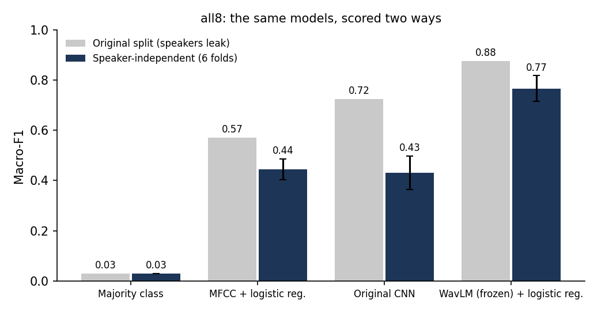
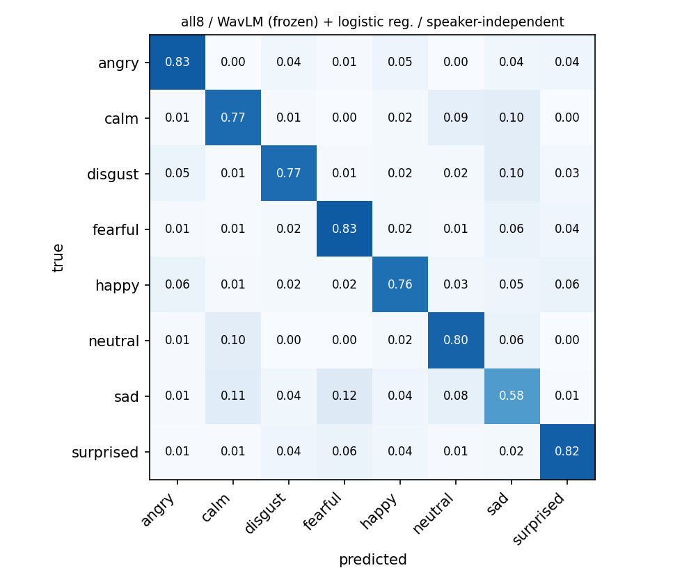

# Speech Emotion Recognition, Evaluated Honestly

[](https://github.com/CODER7657/voice-emotion-detection/actions/workflows/tests.yml)
[](https://colab.research.google.com/github/CODER7657/voice-emotion-detection/blob/main/notebooks/train_colab.ipynb)
[](LICENSE)

Recognizes 8 emotions from short speech clips (RAVDESS), and measures how much the
first version of this project overstated its own accuracy.

Reproducing the first version's evaluation gives its CNN **0.79 macro-F1** on 3 emotions,
but that evaluation leaked in three ways. With the leaks closed, the same CNN scores
**0.64**, and on all 8 emotions it drops from 0.72 to **0.43**, no better than a plain
MFCC baseline. A frozen
pretrained speech model (WavLM) with a linear classifier on top reaches **0.77** on 8
emotions under the honest protocol, but only **0.33** on another dataset's voices
(CREMA-D), and it runs at 505 ms per clip on a laptop-class CPU as ONNX.



## What leaked

| Leak | What the original pipeline did | Fix |
|---|---|---|
| **Speakers** | A random split put all 24 actors in both train and test, so the model could learn voices instead of emotions | Actor-grouped 6-fold cross-validation: each fold tests 4 unseen actors (2 male, 2 female) |
| **Augmentation** | Each clip and an augmented copy were pooled *before* splitting, so a noisy copy of a test clip could be trained on | Augmented copies are made for training actors only |
| **Validation** | The CNN's learning-rate schedule watched the test set | Validation comes from 2 held-out training actors |

[`tests/test_experiment.py`](tests/test_experiment.py) shows the augmentation leak
directly: on labels that are pure noise, a 1-nearest-neighbour model scores far above
chance under the original protocol and at chance under the honest one.

## Results

Macro-F1, the headline metric because neutral has half as many clips as the other
emotions. "Speaker-independent" is the mean ± standard deviation over 6 folds; every
clip is tested exactly once, by a model that never heard that speaker.

| Task | Model | Original split | Speaker-independent |
|---|---|---|---|
| 3 emotions | Majority class | 0.167 | 0.167 ± 0.000 |
| 3 emotions | MFCC statistics + logistic regression | 0.749 | 0.620 ± 0.068 |
| 3 emotions | Original CNN on log-mel spectrograms | 0.787 | 0.638 ± 0.070 |
| 3 emotions | **WavLM (frozen) + logistic regression** | 0.931 | **0.871 ± 0.036** |
| 8 emotions | Majority class | 0.029 | 0.029 ± 0.000 |
| 8 emotions | MFCC statistics + logistic regression | 0.570 | 0.445 ± 0.041 |
| 8 emotions | Original CNN on log-mel spectrograms | 0.724 | 0.430 ± 0.067 |
| 8 emotions | **WavLM (frozen) + logistic regression** | 0.875 | **0.766 ± 0.052** |

Every number is produced by [`notebooks/train_colab.ipynb`](notebooks/train_colab.ipynb)
and stored in [`results/compact.json`](results/compact.json), including per-fold scores,
the actors each fold tested, and the confusion matrices.

**Where the best model still fails.** WavLM's weakest emotion is *sad* (recall 0.58),
mostly confused with *calm* and *fearful*. The original CNN under honest testing
barely recognizes *happy* (0.22) or *neutral* (0.20). The
[model card](MODEL_CARD.md) has per-emotion recall, intended use and what is out of scope.



## Does it work on other voices?

Speaker-independent folds only test new actors from the same studio. To test new
recording conditions too, the six emotions RAVDESS shares with
[CREMA-D](https://github.com/CheyneyComputerScience/CREMA-D) (7,442 clips, 91 actors of
varied age and ethnicity) were used to train on one corpus and test on the other.
Both corpora go through the same loader (silence trimmed, then 3 s).

| WavLM + logistic regression, 6 emotions | Macro-F1 |
|---|---|
| RAVDESS, speaker-independent folds | 0.786 ± 0.054 |
| CREMA-D, speaker-independent folds | 0.702 ± 0.014 |
| **Train RAVDESS, test CREMA-D** | **0.325** |
| Train CREMA-D, test RAVDESS | 0.460 |
| Always predicting one emotion | 0.049 |

**A model that scores 0.79 on RAVDESS scores 0.33 on another dataset's voices.** Trained
on RAVDESS, it labels most CREMA-D clips fearful or sad (neutral recall 0.11, angry
0.19). Training on CREMA-D's 91 speakers transfers better than RAVDESS's 24, which
suggests speaker variety matters more than clip count. The MFCC baseline drops to 0.26.
Numbers: [`results/cross_dataset/summary.json`](results/cross_dataset/summary.json),
from [`scripts/cross_dataset.py`](scripts/cross_dataset.py).

## Running it on a CPU

[`scripts/export_onnx.py`](scripts/export_onnx.py) exports WavLM (with the pooling)
to ONNX and checks it against PyTorch on the same 6 speaker-independent folds
(8 emotions, 1,440 clips, 2 CPU threads, one 3 s clip at a time):

| Embedding backend | Macro-F1 | CPU p50 / p95 | Size |
|---|---|---|---|
| PyTorch fp32 | 0.750 ± 0.072 | 578 / 619 ms | |
| **ONNX fp32 (served)** | **0.749 ± 0.074** | **505 / 546 ms** | 378 MB |
| ONNX int8, dynamic quantisation | 0.657 ± 0.033 | 1,217 / 1,257 ms | 96 MB |

Dynamic int8 quantisation looked like the obvious step and was a bad trade here: the
embeddings drifted (cosine 0.62 against PyTorch), macro-F1 fell 9 points, and it ran
more than twice as slowly on this CPU. The fp32 export matches PyTorch exactly (cosine
1.00) and is 13% faster, so that is what [`src/vemo/serve.py`](src/vemo/serve.py)
serves:

```bash
pip install -e ".[serve,export]"
python scripts/export_onnx.py --ravdess /path/to/ravdess --out models   # once, about 30 min on CPU
uvicorn vemo.serve:app --port 8000
curl -F "file=@clip.wav" localhost:8000/predict
```

The 378 MB model isn't committed; the export recreates it. Report:
[`results/export/export_report.json`](results/export/export_report.json). Both runs:
[`notebooks/cross_dataset_onnx_colab.ipynb`](notebooks/cross_dataset_onnx_colab.ipynb).

## How it works

```
RAVDESS filename  ->  manifest (emotion, actor, gender from the name, never the folder)
audio             ->  16 kHz, skip the 0.5 s of leading silence, keep 3 s
features          ->  MFCC statistics (240) | log-mel spectrogram (128 x 188) | WavLM embedding (768)
protocols         ->  leaky (original, for comparison) | honest (actor-grouped folds)
models            ->  majority floor | logistic regression | original CNN | WavLM + logistic regression
```

| Path | What |
|---|---|
| `src/vemo/ravdess.py` | Filename parser and manifest |
| `src/vemo/splits.py` | Actor-grouped folds and the leaky split |
| `src/vemo/features.py` | Loading, train-only augmentation, MFCC and log-mel features |
| `src/vemo/ssl.py` | Frozen WavLM embeddings |
| `src/vemo/models.py` | Majority floor, logistic regression, the original CNN unchanged |
| `src/vemo/experiment.py` | Runs a model under either protocol on identical features |
| `scripts/run_experiments.py` | Runs everything and writes `results/` |
| `scripts/plot_results.py` | Rebuilds tables and charts from `results/compact.json` |

## Reproduce

Training runs on a free Colab GPU, about 25 minutes:

1. Open [`notebooks/train_colab.ipynb`](https://colab.research.google.com/github/CODER7657/voice-emotion-detection/blob/main/notebooks/train_colab.ipynb) in Colab
2. Runtime → Change runtime type → T4 GPU
3. Runtime → Run all

The notebook downloads RAVDESS speech (about 200 MB) onto the Colab machine only.

Locally, the tests need no audio data or GPU and finish in seconds. CI runs them on
Python 3.11 and 3.12 for every push and pull request:

```bash
pip install -e ".[dev]"
pytest
```

## Limitations

- **Acted speech.** RAVDESS is 24 North American actors reading two fixed sentences.
  Scores on spontaneous speech, other accents or noisy microphones will be lower, and
  are not measured here.
- **WavLM is frozen and not augmented.** Fine-tuning it would likely score higher; that
  is the next step.
- **The CNN is deliberately unchanged** from the first version, so the comparison
  isolates the evaluation. It is not tuned.
- **Fold-to-fold spread is real.** With 4 test actors per fold, scores move by ±0.05
  depending on which voices are held out.

## Desktop app (v1)

`emotion_gui.py` (live microphone with waveform and spectrogram) and `app.py` (terminal)
are the original app. They still use the first version's 3-emotion CNN and are not
evaluated by this pipeline.

```bash
pip install -r requirements.txt
python emotion_gui.py
```

## Data and license

Code: MIT, see [LICENSE](LICENSE).
Data: [RAVDESS](https://zenodo.org/records/1188976) (Livingstone & Russo, 2018), licensed
CC BY-NC-SA 4.0. No audio is stored in this repository.
