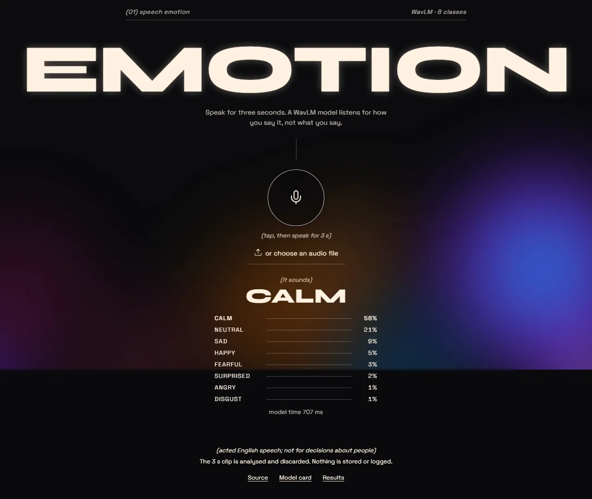
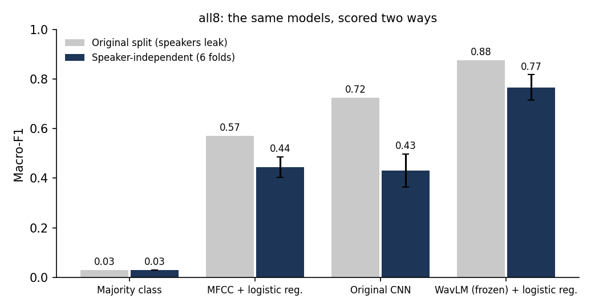
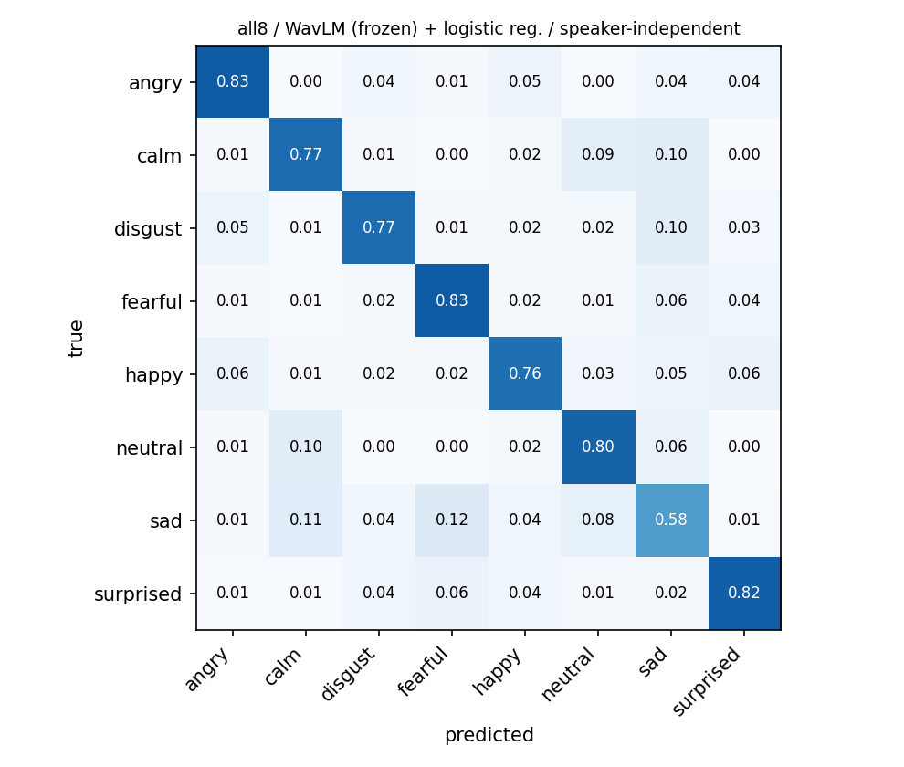
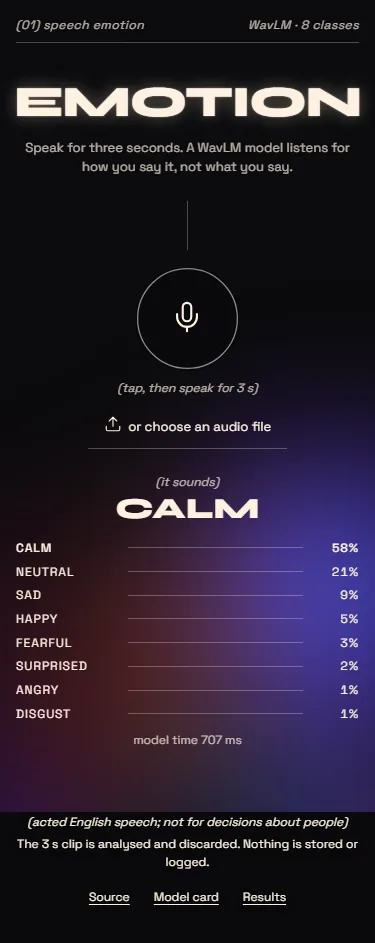

# Speech Emotion Recognition, Evaluated Honestly

[](https://github.com/CODER7657/voice-emotion-detection/actions/workflows/tests.yml)
[](https://colab.research.google.com/github/CODER7657/voice-emotion-detection/blob/main/notebooks/train_colab.ipynb)
[](LICENSE)
[](https://vemo-api.vercel.app)

**Live:** <https://vemo-api.vercel.app>. Record three seconds or choose a file
([how the web app works](#web-app)).



Recognizes 8 emotions from short speech clips (RAVDESS), and measures how much the
first version of this project overstated its own accuracy.

Reproducing the first version's evaluation gives its CNN **0.79 macro-F1** on 3 emotions,
but that evaluation leaked in three ways. With the leaks closed, the same CNN scores
**0.64**, and on all 8 emotions it drops from 0.72 to **0.43**, no better than a plain
MFCC baseline. A frozen
pretrained speech model (WavLM) with a linear classifier on top reaches **0.77** on 8
emotions under the honest protocol, but only **0.33** on another dataset's voices
(CREMA-D), and it runs at 505 ms per clip on a laptop-class CPU as ONNX.



## What leaked

| Leak | What the original pipeline did | Fix |
|---|---|---|
| **Speakers** | A random split put all 24 actors in both train and test, so the model could learn voices instead of emotions | Actor-grouped 6-fold cross-validation: each fold tests 4 unseen actors (2 male, 2 female) |
| **Augmentation** | Each clip and an augmented copy were pooled *before* splitting, so a noisy copy of a test clip could be trained on | Augmented copies are made for training actors only |
| **Validation** | The CNN's learning-rate schedule watched the test set | Validation comes from 2 held-out training actors |

[`tests/test_experiment.py`](tests/test_experiment.py) shows the augmentation leak
directly: on labels that are pure noise, a 1-nearest-neighbour model scores far above
chance under the original protocol and at chance under the honest one.

## Results

Macro-F1, the headline metric because neutral has half as many clips as the other
emotions. "Speaker-independent" is the mean ± standard deviation over 6 folds; every
clip is tested exactly once, by a model that never heard that speaker.

| Task | Model | Original split | Speaker-independent |
|---|---|---|---|
| 3 emotions | Majority class | 0.167 | 0.167 ± 0.000 |
| 3 emotions | MFCC statistics + logistic regression | 0.749 | 0.620 ± 0.068 |
| 3 emotions | Original CNN on log-mel spectrograms | 0.787 | 0.638 ± 0.070 |
| 3 emotions | **WavLM (frozen) + logistic regression** | 0.931 | **0.871 ± 0.036** |
| 8 emotions | Majority class | 0.029 | 0.029 ± 0.000 |
| 8 emotions | MFCC statistics + logistic regression | 0.570 | 0.445 ± 0.041 |
| 8 emotions | Original CNN on log-mel spectrograms | 0.724 | 0.430 ± 0.067 |
| 8 emotions | **WavLM (frozen) + logistic regression** | 0.875 | **0.766 ± 0.052** |

Every number is produced by [`notebooks/train_colab.ipynb`](notebooks/train_colab.ipynb)
and stored in [`results/compact.json`](results/compact.json), including per-fold scores,
the actors each fold tested, and the confusion matrices.

**Where the best model still fails.** WavLM's weakest emotion is *sad* (recall 0.58),
mostly confused with *calm* and *fearful*. The original CNN under honest testing
barely recognizes *happy* (0.22) or *neutral* (0.20). The
[model card](MODEL_CARD.md) has per-emotion recall, intended use and what is out of scope.



## Does it work on other voices?

Speaker-independent folds only test new actors from the same studio. To test new
recording conditions too, the six emotions RAVDESS shares with
[CREMA-D](https://github.com/CheyneyComputerScience/CREMA-D) (7,442 clips, 91 actors of
varied age and ethnicity) were used to train on one corpus and test on the other.
Both corpora go through the same loader (silence trimmed, then 3 s).

| WavLM + logistic regression, 6 emotions | Macro-F1 |
|---|---|
| RAVDESS, speaker-independent folds | 0.786 ± 0.054 |
| CREMA-D, speaker-independent folds | 0.702 ± 0.014 |
| **Train RAVDESS, test CREMA-D** | **0.325** |
| Train CREMA-D, test RAVDESS | 0.460 |
| Always predicting one emotion | 0.049 |

**A model that scores 0.79 on RAVDESS scores 0.33 on another dataset's voices.** Trained
on RAVDESS, it labels most CREMA-D clips fearful or sad (neutral recall 0.11, angry
0.19). Training on CREMA-D's 91 speakers transfers better than RAVDESS's 24, which
suggests speaker variety matters more than clip count. The MFCC baseline drops to 0.26.
Numbers: [`results/cross_dataset/summary.json`](results/cross_dataset/summary.json),
from [`scripts/cross_dataset.py`](scripts/cross_dataset.py).

## Running it on a CPU

[`scripts/export_onnx.py`](scripts/export_onnx.py) exports WavLM (with the pooling)
to ONNX and checks it against PyTorch on the same 6 speaker-independent folds
(8 emotions, 1,440 clips, 2 CPU threads, one 3 s clip at a time):

| Embedding backend | Macro-F1 | CPU p50 / p95 | Size |
|---|---|---|---|
| PyTorch fp32 | 0.750 ± 0.072 | 578 / 619 ms | |
| ONNX fp32 | 0.749 ± 0.074 | 505 / 546 ms | 378 MB |
| **ONNX, fp16-stored weights (served)** | **0.750** | as fp32 (compute is fp32) | **190 MB** |
| ONNX int8, dynamic quantisation | 0.657 ± 0.033 | 1,217 / 1,257 ms | 96 MB |

Dynamic int8 quantisation looked like the obvious step and was a bad trade here: the
embeddings drifted (cosine 0.62 against PyTorch), macro-F1 fell 9 points, and it ran
more than twice as slowly on this CPU. The fp32 export matches PyTorch exactly (cosine
1.00) and is 13% faster. The served copy stores those same weights as fp16
([`scripts/to_fp16.py`](scripts/to_fp16.py)) and [`src/vemo/serve.py`](src/vemo/serve.py)
upcasts them to fp32 when it loads, so only the weights are rounded, never the
arithmetic. Measured 2026-11-08 on all 1,440 clips: cosine 1.000000 (mean and minimum)
against the fp32 model, and macro-F1 0.7501 on the same 6 folds (fp32: 0.7487), at half
the size:

```bash
pip install -e ".[serve,export]"
python scripts/export_onnx.py --ravdess /path/to/ravdess --out models   # once, about 30 min on CPU
python scripts/to_fp16.py                                               # models/wavlm_pooled_fp16w.onnx
uvicorn vemo.serve:app --port 8000
curl -F "file=@clip.wav" localhost:8000/predict
```

Neither model is committed; the export recreates them, and the fp16 copy is published as the `model-v1` release asset with its sha256. Report:
[`results/export/export_report.json`](results/export/export_report.json). Both runs:
[`notebooks/cross_dataset_onnx_colab.ipynb`](notebooks/cross_dataset_onnx_colab.ipynb).

### Web app

**Try it: <https://vemo-api.vercel.app>.** Record three seconds (or choose a file) and
eight glows, one per emotion, light up with the model's probabilities.

| 375 px | 1280 px |
|---|---|
|  |  |

[`web/`](web) is a small Vite + TypeScript site (4.8 kB of JavaScript gzipped, no
framework) in the Aurora style: tokens in [`web/src/tokens.css`](web/src/tokens.css),
self-hosted Syne and Space Grotesk, Lucide icons, `prefers-reduced-motion` respected.
It prepares audio the way the model was trained: decode, mono, resample to 16 kHz
(`OfflineAudioContext`, or a Kaiser-windowed sinc where a 16 kHz context is refused),
trim silence with a TypeScript port of the trim that is checked against
[`src/vemo/trim.py`](src/vemo/trim.py) on shared fixtures, then exactly 3 s. In the
browser end to end test the request body correlates above 0.99 with what
`librosa.load` + `vemo.trim` make of the same file. It is served from the same origin
as the API (Vercel's CDN, `public/`), so there is no CORS, under a strict CSP with no
inline script or style ([`web/security-headers.json`](web/security-headers.json)).

Checks ([`.github/workflows/web.yml`](.github/workflows/web.yml)): ESLint (strict, type
checked), Prettier, `tsc`, 37 Vitest unit tests, and Playwright at 375, 768 and 1280 px
in Chromium (with a fake microphone playing a synthetic clip, so the record path runs)
and WebKit as an iPhone, with axe (zero serious or critical issues). Lighthouse mobile on
the deployed site (2026-11-08, median of 3): performance 100, accessibility 100, best
practices 100, SEO 100; LCP 1.2 s, CLS 0. iOS Safari itself has not been tested on a
device; WebKit is the stand-in. `VEMO_LIVE_URL=https://vemo-api.vercel.app npx playwright
test live` (in `web/`) runs the real model through the real page.

### Live API

`api/index.py` serves the same model as a Vercel Python function at <https://vemo-api.vercel.app>.
There is no audio decoding on the server: the browser records, resamples to 16 kHz
mono and sends exactly 3 s as raw samples. The server trims silence (the NumPy port in
`vemo.trim`), runs the fp16-stored WavLM (upcast to fp32) and the logistic-regression
head. The function depends only on numpy, onnx, onnxruntime and fastapi
([`api/requirements.txt`](api/requirements.txt)).

| | |
|---|---|
| `POST /predict` | body: 48,000 float32 little-endian samples (192,000 bytes), `Content-Type: application/octet-stream` |
| `GET /health` | liveness; never loads the model |
| `GET /ready` | 200 once the model and head are present, the sha256 matches the pin, and the session loads; otherwise 503 naming the missing part |
| Errors | 400 wrong length, NaN/Inf, silence or a single steady tone; 413 body over 256 KB; 415 unless `Content-Type` is exactly `application/octet-stream` (also when missing); 429 over 20 requests/min per IP (with `Retry-After`); 503 model unavailable (missing, sha256 mismatch, invalid head, or a transient load error that the next request retries) |
| CORS | only the origins listed in `ALLOWED_ORIGINS` (exact https origins); none by default |

```bash
# make a 3 s, 16 kHz mono float32 file from any clip (needs librosa locally, not on the server)
python -c "import librosa, numpy as np; y,_ = librosa.load('clip.wav', sr=16000, mono=True); \
y = np.pad(y[:48000], (0, max(0, 48000 - len(y)))); y.astype('<f4').tofile('clip.f32')"
curl -s -X POST --data-binary @clip.f32 -H 'Content-Type: application/octet-stream' 'https://vemo-api.vercel.app/predict'
```

```json
{"emotion": "angry", "probabilities": {"angry": 0.91, "...": "all 8, sorted, 4 dp"},
 "inference_ms": 110.0, "model_sha256": "ea666f45...", "note": "Trained on acted English speech (RAVDESS). Not for decisions about people."}
```

`model_sha256` is the hash verified against the `MODEL_SHA256` pin (the deploy always
sets it); without a pin the hash is not computed and the field is `null`.

Trained on acted English speech (RAVDESS). Not for decisions about people: it has not
been validated on spontaneous speech, other languages, or anyone's real emotional state.

Measured locally on this CPU (2026-11-08, in-process, real `model-v1` model,
[`scripts/check_api_real_model.py`](scripts/check_api_real_model.py), 20 RAVDESS clips
sent as the browser would, two runs): `inference_ms` p50 110-122 ms, p95 123-137 ms;
first request (load, upcast, sha256 and one inference) 2.3-2.5 s. All 20 predictions matched the label,
but the served head was fitted on all 1,440 RAVDESS clips, so that is an end-to-end
check, not accuracy; the speaker-independent numbers are in [Results](#results).

On Vercel (2026-11-08, a preview deployment of this exact bundle, Hobby 2 GB / 1 vCPU,
10 RAVDESS clips sent from India): server `inference_ms` p50 707 ms; round trip p50 883 ms;
first `/ready` after deploy (cold start: load, upcast, sha256) 7.0 s. The
shared vCPU is about 6x slower than the local CPU above.

Deploys run from [`.github/workflows/deploy.yml`](.github/workflows/deploy.yml) on pushes
to `main`, only after the full test suite passes: download `model-v1` and check `SHA256SUMS`, build the bundle with
[`scripts/build_vercel_bundle.py`](scripts/build_vercel_bundle.py), smoke-test it with
the real model, deploy, then poll `/health` and `/ready` on the production alias ([`scripts/check_deployment.py`](scripts/check_deployment.py): fails unless both answer 200; only a Deployment Protection 401/403 is a warning). Vercel's Hobby plan caps CLI
uploads at 100 MB, so the bundle (0.2 MB) carries a build step that downloads the 190 MB
asset on Vercel and verifies its sha256; function size is 374 MB (model 190 MB plus
dependencies 184 MB) against Vercel's 500 MB limit for Python functions.

## How it works

```
RAVDESS filename  ->  manifest (emotion, actor, gender from the name, never the folder)
audio             ->  16 kHz, skip the 0.5 s of leading silence, keep 3 s
features          ->  MFCC statistics (240) | log-mel spectrogram (128 x 188) | WavLM embedding (768)
protocols         ->  leaky (original, for comparison) | honest (actor-grouped folds)
models            ->  majority floor | logistic regression | original CNN | WavLM + logistic regression
```

| Path | What |
|---|---|
| `src/vemo/ravdess.py` | Filename parser and manifest |
| `src/vemo/splits.py` | Actor-grouped folds and the leaky split |
| `src/vemo/features.py` | Loading, train-only augmentation, MFCC and log-mel features |
| `src/vemo/ssl.py` | Frozen WavLM embeddings |
| `src/vemo/models.py` | Majority floor, logistic regression, the original CNN unchanged |
| `src/vemo/experiment.py` | Runs a model under either protocol on identical features |
| `scripts/run_experiments.py` | Runs everything and writes `results/` |
| `scripts/plot_results.py` | Rebuilds tables and charts from `results/compact.json` |

## Reproduce

Training runs on a free Colab GPU, about 25 minutes:

1. Open [`notebooks/train_colab.ipynb`](https://colab.research.google.com/github/CODER7657/voice-emotion-detection/blob/main/notebooks/train_colab.ipynb) in Colab
2. Runtime → Change runtime type → T4 GPU
3. Runtime → Run all

The notebook downloads RAVDESS speech (about 200 MB) onto the Colab machine only.

Locally, the tests need no audio data or GPU and finish in seconds. CI runs them on
Python 3.11 and 3.12 for every push and pull request:

```bash
pip install -e ".[dev]"
pytest
```

**Evaluation gate.** [`tests/test_eval_gate.py`](tests/test_eval_gate.py) re-runs the
6-fold actor-grouped evaluation in CI on the committed embeddings
([`models/embeddings_onnx_fp32.npz`](models/embeddings_onnx_fp32.npz), 2 MB, one WavLM
embedding per RAVDESS clip from the served ONNX export), so no audio or model is needed.
The build fails if speaker-independent macro-F1 drops below **0.72** (measured
2026-11-08: 0.751 ± 0.070) or if refitting the classifier disagrees with the shipped
[`models/head.json`](models/head.json) on more than 1% of clips. Both checks were shown
to fail: an over-regularised head scored 0.388, and a tampered head agreed on 7.9%.
The embeddings and head are derived from RAVDESS (CC BY-NC-SA 4.0, see [NOTICE](NOTICE)).

`vemo.trim` is a NumPy-only port of the silence trim the model was trained behind
(`librosa.effects.trim`, `top_db=30`, then 3 s), so serving does not need librosa.
Measured 2026-11-07: start and end samples identical to librosa (maximum
difference 0; the test allows ±1) on 50 synthetic clips in CI and on 50 RAVDESS
clips locally. To repeat the real-speech check, point it at a folder of `.wav` files:

```bash
VEMO_CLIPS_DIR=/path/to/wavs pytest tests/test_trim.py
```

## Limitations

- **Acted speech.** RAVDESS is 24 North American actors reading two fixed sentences.
  Scores on spontaneous speech, other accents or noisy microphones will be lower, and
  are not measured here.
- **WavLM is frozen and not augmented.** Fine-tuning it would likely score higher; that
  is the next step.
- **The CNN is deliberately unchanged** from the first version, so the comparison
  isolates the evaluation. It is not tuned.
- **Fold-to-fold spread is real.** With 4 test actors per fold, scores move by ±0.05
  depending on which voices are held out.

## Desktop app (v1)

`emotion_gui.py` (live microphone with waveform and spectrogram) and `app.py` (terminal)
are the original app. They still use the first version's 3-emotion CNN and are not
evaluated by this pipeline.

```bash
pip install -r requirements.txt
python emotion_gui.py
```

## Data and license

Code: MIT, see [LICENSE](LICENSE).
Data: [RAVDESS](https://zenodo.org/records/1188976) (Livingstone & Russo, 2018), licensed
CC BY-NC-SA 4.0. No audio is stored in this repository.
